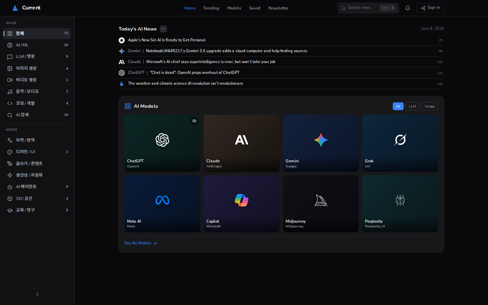
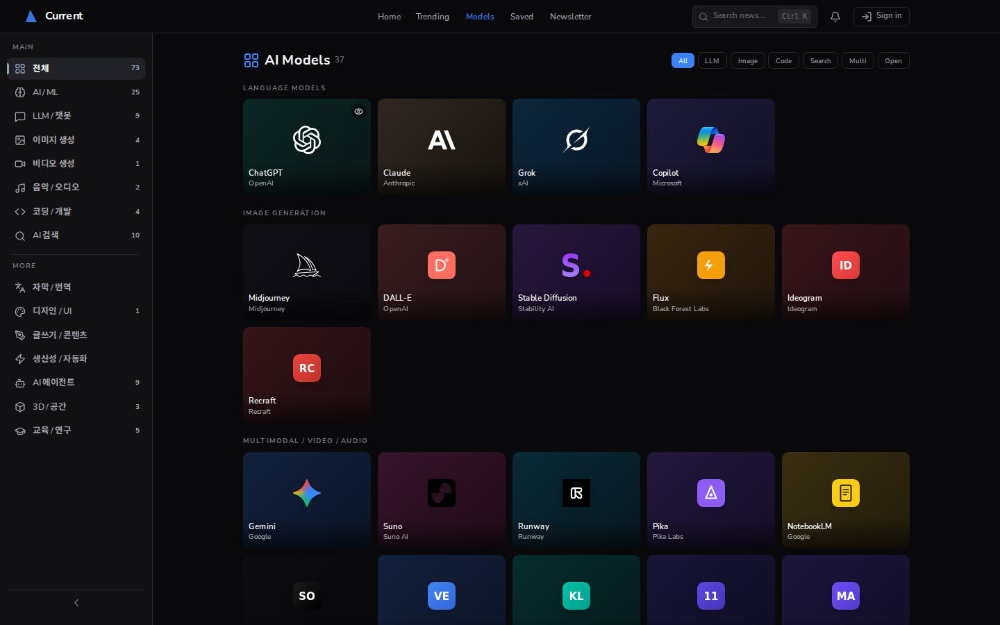
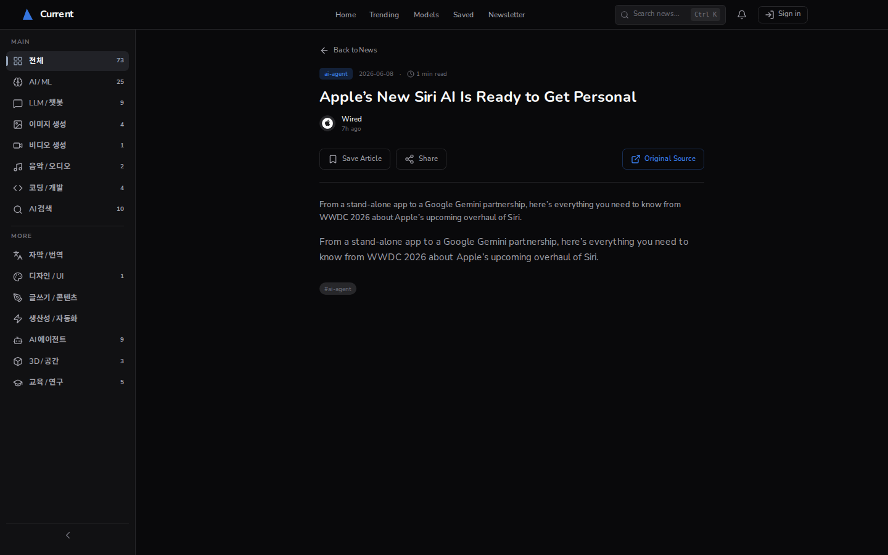

<!-- PROJECT BANNER -->
<!-- TODO: 배너 이미지를 만들면 아래 주석을 풀어 표시 (권장 1280×320, 상어 지느러미 + "Current" 로고)
  
-->
<div align="center">
  <h1>🌊 Current <sub>by Jyos</sub></h1>

  <p>
    <b>AI 소식을 자동으로 모아 한국어로 보여주고,</b><br/>
    <b>내 작업에 맞는 AI 모델을 직접 비교해 고르게 돕는 서비스</b>
  </p>

  <!-- BADGES -->
  <p>
    
    
    
    
    
    
  </p>

  <p>
    <a href="https://current-rho.vercel.app/"><b>🔗 Live Demo</b></a>
    &nbsp;·&nbsp;
    <a href="#-시작하기"><b>🚀 시작하기</b></a>
    &nbsp;·&nbsp;
    <a href="#-로드맵"><b>🗺 로드맵</b></a>
  </p>
</div>

---

## 📖 소개

**Current**는 AI를 잘 모르는 사람도 "그래서 나는 어떤 AI를 쓰면 되지?"에 답할 수 있게 돕는 서비스입니다.

- **뉴스** — Claude, ChatGPT, Gemini 등 AI 모델 기사를 RSS로 자동 수집하고, **Claude API**로 분류·한국어 번역해
  카드형 UI로 정리합니다. 새 모델 출시·긴급 소식은 **Hot**으로 홈 상단에 보여줍니다.
- **비교** — 내 질문 하나를 **OpenRouter**로 여러 모델에 동시에 보내고, 이름을 가린 채(블라인드) 답을 비교해
  가장 마음에 드는 답을 고릅니다. 고른 뒤에 모델 이름·비용이 공개됩니다.

> 💡 컴퓨터공학부 졸업 프로젝트(9개월) — 실서비스 론칭 및 수익화를 목표로 1인 개발 중입니다.

<br/>

<!-- SCREENSHOTS -->
<!-- TODO: 실제 스크린샷으로 교체 (대시보드 / 모델 페이지 / 기사 상세) -->
<div align="center">
  
  <br/><br/>
  <table>
    <tr>
      <td></td>
      <td></td>
    </tr>
  </table>
</div>

---

## ✨ 주요 기능

- 📰 **AI 뉴스 자동 수집** — 주요 매체 RSS를 크롤링해 AI 모델·기술 기사만 선별 수집
- 🤖 **Claude 기반 분류** — Claude Haiku로 카테고리·모델을 자동 태깅 (키워드 + LLM 하이브리드)
- 🗂 **카드형 대시보드** — 14개 카테고리 필터, 모델별 페이지/상세 모달, 전문 검색
- ⭐ **사용자별 북마크** — Google 로그인(OAuth) 후 관심 기사 저장 → `/saved`
- 📚 **News** — 날짜별 전체 기사 목록 (카테고리·검색·기간 필터)
- 🔥 **Hot** — 새 모델 출시·긴급 뉴스를 사건 단위로 묶어 홈 상단에 표시
- 🌐 **한국어 번역 / 다국어** — 기사 자동 번역, 사이트 한국어·영어 전환
- 📬 **Newsletter** — 매일 아침 중요한 기사만 골라 요약
- ⚖️ **모델 비교** — 샘플 하나를 모델 3개에 병렬 실행, 블라인드 선택 후 공개, 판정 AI가 작업 유형 자동 분류
- 🏆 **(예정) 순위·추천** — 작업 유형별 전체/내 순위, 순위 기반 모델 추천

---

## 🛠 기술 스택

| 영역 | 기술 |
|------|------|
| **프론트엔드** | Next.js 16 (App Router), React 19, TypeScript (strict), Tailwind CSS v4, framer-motion |
| **백엔드** | Next.js Route Handlers (REST API), Node 크롤러 (rss-parser) |
| **DB / 인증** | Supabase (PostgreSQL, Auth + Google OAuth, RLS), 검색(원문+한국어 부분 일치, pg_trgm) |
| **AI** | Claude API (Anthropic) — 기사 분류·번역·Hot 판정·작업 유형 묶기 / OpenRouter — 비교 대상 모델 실행 |
| **인프라** | Vercel (배포), GitHub Actions (크롤러 cron, 12시간 주기) |

---

## 🏗 아키텍처

<!-- TODO: 다이어그램 이미지로 교체하면 더 좋음 (docs/architecture.png) -->

```
                      ┌──────────────────────────┐
   RSS 피드 ───────▶  │  크롤러 (Node, cron 12h)  │ ── Claude Haiku 분류·번역·Hot
                      │  scripts/crawl-articles   │
                      └────────────┬─────────────┘
                                   │ upsert (service_role)
                                   ▼
   ┌──────────────┐        ┌──────────────┐        ┌─────────────────┐
   │   브라우저    │ ◀────▶ │  Next.js App  │ ◀────▶ │    Supabase      │
   │  (대시보드)   │  HTTP  │  /app, /api   │  SQL   │ Postgres+Auth+RLS │
   └──────────────┘        └──────┬───────┘        └─────────────────┘
                                   │ 비교 실행 (서버 키 / 블라인드)
                                   ▼
                          ┌──────────────┐
                          │  OpenRouter   │  GPT · Gemini · Claude 등 344개 모델
                          └──────────────┘
```

**디렉터리 구조 (요약)**

```
src/
├─ app/
│  ├─ (dashboard)/      # 홈(뉴스↔비교)·news·models·article·saved·newsletter
│  ├─ api/              # articles · ai-models · bookmarks · hot · newsletter · catalog · tasks · comparisons
│  └─ auth/callback/    # Google OAuth 콜백
├─ components/          # NewsCard · ModelCard · Sidebar · Header · compare/* 등
├─ modules/             # account · catalog · task · execution · comparison · evaluation (비교 도메인 로직)
└─ lib/
   ├─ supabase/         # client / server / middleware / schema.sql
   ├─ hooks/            # useArticles · useBookmarks · useAuth …
   └─ constants.ts · types.ts · transforms.ts · security.ts
scripts/crawl-articles.mjs   # RSS 크롤러 (키워드 + Claude 분류·번역·Hot)
scripts/newsletter.mjs       # 아침 뉴스레터 생성
```

---

## 🚀 시작하기

### 사전 준비
- Node.js 20+ (권장 24)
- Supabase 프로젝트 ([dashboard](https://supabase.com/dashboard)에서 생성)
- (선택) Anthropic API 키 — 크롤러 LLM 분류용

### 설치 및 실행

```bash
# 1. 클론 & 의존성 설치
git clone https://github.com/<your-id>/current.git
cd current
npm install

# 2. 환경변수 설정 (.env.example 참고)
cp .env.example .env.local
# .env.local 을 열어 Supabase 키 등을 채워 넣으세요

# 3. DB 스키마 적용
# Supabase SQL Editor에서 src/lib/supabase/schema.sql 실행

# 4. 개발 서버 실행 (⚠️ 반드시 포트 3003)
npx next dev -p 3003
```

➡️ http://localhost:3003 접속

> ⚠️ **포트는 반드시 3003입니다.** OAuth redirect URL이 `localhost:3003` 기준으로
> 설정되어 있어, 다른 포트로 띄우면 로그인 리다이렉트가 깨집니다.

### 환경변수

| 변수 | 설명 |
|------|------|
| `NEXT_PUBLIC_SUPABASE_URL` | Supabase 프로젝트 URL |
| `NEXT_PUBLIC_SUPABASE_ANON_KEY` | Supabase anon 키 |
| `SUPABASE_SERVICE_ROLE_KEY` | 크롤러용 service_role 키 (RLS 우회) |
| `NEXT_PUBLIC_SITE_URL` | OAuth redirect 기준 URL |
| `ANTHROPIC_API_KEY` | Claude 분류·번역·판정용 |
| `OPENROUTER_API_KEY` | 모델 비교 실행용 (서버 키) |

### 뉴스 크롤링 (수동 실행)

```bash
node scripts/crawl-articles.mjs          # 크롤 + Supabase 적재
node scripts/crawl-articles.mjs --dry    # JSON 스냅샷만 (DB 미반영)
node scripts/crawl-articles.mjs --no-llm # LLM 분류 생략 (키워드만)
```

---

## 🗺 로드맵

> 2026-10-15 방향 전환: 주가 연동·ESP32 하드웨어·기업 주식 분석은 접고, 뉴스 위에 **모델 비교 서비스**를 붙였습니다.

- [x] AI 뉴스 대시보드 (수집·분류·번역·UI·북마크·Hot·뉴스레터)
- [x] 비교 1단계 — 블라인드 비교 (실행·선택·공개·작업 유형 자동 분류)
- [ ] 비교 1단계 마무리 — 내 비교 기록, 비용·RLS 검증
- [ ] 비교 2단계 — 작업 유형별 전체/내 순위 → 추천
- [ ] 비교 3단계 — 일관성 측정 · 비용 시뮬레이터 · 개인 키
- [ ] 비교 4단계 — 새 모델 출시 뉴스 → "내 작업으로 비교해 보기"

> 자세한 기획·로드맵은 [`PROJECT_CONTEXT.md`](PROJECT_CONTEXT.md) 참고.

---

## 📝 라이선스

<!-- TODO: 라이선스 결정 (MIT 권장 / 또는 비공개면 명시) -->
이 프로젝트는 졸업 프로젝트 및 개인 서비스 목적으로 개발 중입니다.

---

<div align="center">
  <sub>Built by <b>Jyos</b> · Current 🌊</sub>
</div>
